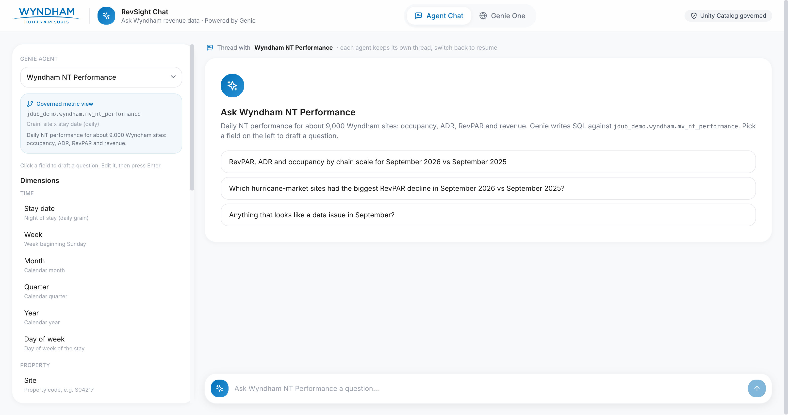
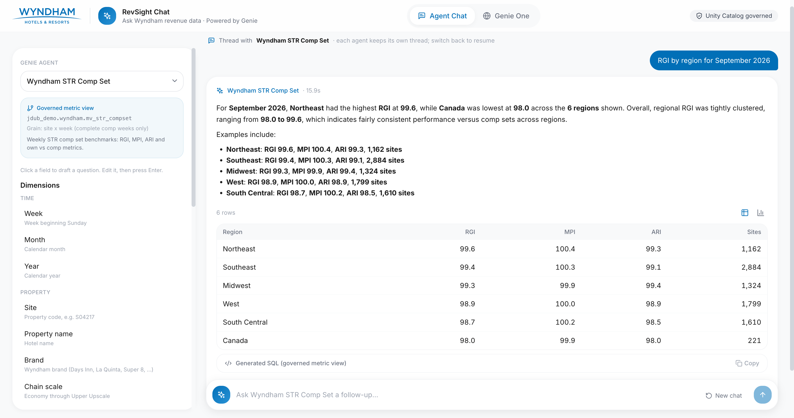
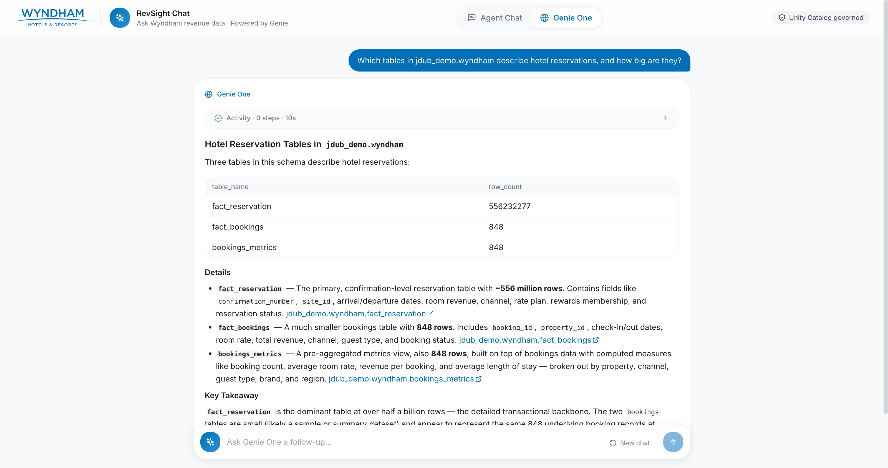
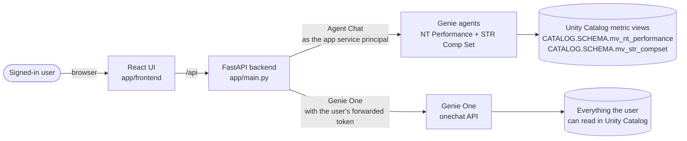

<div align="center">


# RevSight Chat

**Ask Wyndham revenue data in plain English, on governed Unity Catalog metric views.**

[](https://docs.databricks.com/aws/en/dev-tools/databricks-apps/)
[](https://docs.databricks.com/aws/en/genie/)
[](https://docs.databricks.com/aws/en/genie/)
[](https://docs.databricks.com/aws/en/metric-views/)
[](https://fastapi.tiangolo.com/)
[](https://vitejs.dev/)

</div>

<p align="center">
  
</p>

---

## ✨ What it does

| | Feature | What you get |
|---|---|---|
| 💬 | **Agent Chat** | Talk to two curated Genie agents: **NT Performance** (daily occupancy, ADR, RevPAR) and **STR Comp Set** (weekly RGI, MPI, ARI). Each agent keeps its own thread. |
| 🧭 | **Dimensions and Measures rail** | Every field in the agent's metric view, with a one-line meaning. Click one to draft a question or a follow-up. |
| 📊 | **Answers you can check** | Summary, result table, auto chart, and the generated SQL against the governed metric view. |
| 🌐 | **Genie One** | One box that searches everything you can access in Unity Catalog, with a live activity trail of what Genie is reading. |
| 🔐 | **Runs as you** | Genie One uses on-behalf-of (OBO) auth, so answers respect each user's own Unity Catalog permissions. |

<table>
  <tr>
    <td width="50%"></td>
    <td width="50%"></td>
  </tr>
  <tr>
    <td align="center"><sub>Agent Chat: RGI by region from the STR agent</sub></td>
    <td align="center"><sub>Genie One: finds the right tables on its own</sub></td>
  </tr>
</table>

## 🏗️ How it works



- **Agent Chat** calls each Genie space as the **app's service principal**, so the app needs access to the spaces and the schema.
- **Genie One** calls the onechat API with the **user's own token** (Databricks Apps forwards it in `X-Forwarded-Access-Token`), so it only sees what that user can see.

## 🚀 Quick start

> [!NOTE]
> **This app does not build any data.** It reads the metric views and Genie spaces created by the companion repo **[wyndham-revsight](https://github.com/jonathan-whiteley/wyndham-revsight)**. Set that up first (or point `config.env` at an existing copy).

**Choose your path:**

| | Path | You need | Best for |
|---|---|---|---|
| ☁️ | **Option A: in your Databricks workspace** (recommended) | A browser | Most people. No CLI, Node or Python on your laptop |
| 💻 | **Option B: from your laptop** | Databricks CLI, Node 18+, Python 3.11+ | Changing the code, local development |
| 📦 | **Option C: Declarative Automation Bundles (DABs)** | Databricks CLI | Repeatable, versioned deploys and CI/CD |

### ☁️ Option A: in your Databricks workspace (recommended)

Everything happens in the workspace UI. Genie Code can fill in the config and drive the deployment for you, using the [`workspace_deploy`](workspace_deploy.py) notebook in this repo.

0. **Prerequisite:** [wyndham-revsight](https://github.com/jonathan-whiteley/wyndham-revsight) is deployed in your workspace, or its metric views and two Genie spaces already exist somewhere you can read.
1. **Connect GitHub (private repo):** you need access to this GitHub repo, and a GitHub credential linked in the workspace: **Settings > Linked accounts > Git integration**, provider GitHub (OAuth or a personal access token with `repo` scope).
2. **Create a Git folder:** **Workspace > Create > Git folder**, paste `https://github.com/jonathan-whiteley/wyndham-revsight-chat`, and create it (it lands under your home folder).
3. **Let Genie Code do the rest:** open the new folder, open **Genie Code** in agent mode and paste:

   ```text
   I want to deploy the RevSight Chat app from this Git folder.
   1. Find the SQL warehouse I should use (prefer the one my Wyndham Genie spaces run on).
   2. Find the catalog.schema that contains the metric views mv_nt_performance and mv_str_compset.
   3. Find my two Wyndham Genie spaces: "Wyndham NT Performance" and "Wyndham STR Comp Set", and get their IDs.
   4. Pick an APP_NAME nobody in this workspace uses yet (lowercase, dashes), for example revsight-chat-<my first name>.
   If you can't find something, ask me instead of guessing.
   Then edit config.env in this folder with those values (leave DATABRICKS_PROFILE, APP_SOURCE_PATH and USER_API_SCOPES as they are)
   and show me the diff. After I confirm, open the workspace_deploy notebook and run its cells in order on serverless.
   If a cell fails, stop and explain the error and how to fix it. Finish by giving me the app URL.
   ```

4. **Or do it by hand:** edit `config.env` in the Git folder (see the settings table in the next section), open **`workspace_deploy`**, attach **Serverless**, and click **Run all**. Every cell is safe to re-run.
5. **Open the app URL** printed at the end, sign in, and approve the permission prompt (consent). After a scope change, reload and approve again.

What the notebook does: reads `config.env`, checks the warehouse, metric views and Genie spaces exist, creates the app and binds its resources and scopes in one update, grants the app's service principal access (or prints the statements for your schema owner), uploads the runtime files and deploys. To pick up new code later: **Pull** in the Git folder, then run the notebook again.

### 💻 Option B: from your laptop (CLI)

**You need:** the [Databricks CLI](https://docs.databricks.com/aws/en/dev-tools/cli/install) logged in (`databricks auth login --profile <name>`), Node 18+, Python 3.11+.

1. **Build the data and the two Genie spaces** with [wyndham-revsight](https://github.com/jonathan-whiteley/wyndham-revsight). Note the catalog, schema and the two Genie space IDs.
2. **Edit [`config.env`](config.env)**: profile, app name, catalog, schema, warehouse, Genie space IDs. See the table below.
3. **Create the app and bind its resources** (warehouse, both Genie spaces, user scopes):
   ```bash
   zsh scripts/bind_resources.sh
   ```
4. **Grant the app access to your data and spaces** (needs GRANT rights on the schema, see below):
   ```bash
   zsh scripts/grant_app_access.sh
   ```
5. **Deploy:**
   ```bash
   (cd app/frontend && npm install)
   zsh scripts/deploy.sh
   ```
6. **Open the app** from **Compute > Apps > your app**, sign in and accept the permission prompt.

Redeploying after a code change is just step 5.

### 📦 Option C: Declarative Automation Bundles (DABs)

The bundle in [`databricks.yml`](databricks.yml) defines the app (warehouse, both Genie spaces, user scopes, `CATALOG`/`SCHEMA` env) and a small serverless job that grants the app's service principal access. **It reads its settings from bundle variables (`--var` or a target in `databricks.yml`), not from `config.env`.**

1. **Validate** (pick an app name nobody in the workspace uses):
   ```bash
   databricks bundle validate --strict -t dev --var app_name=revsight-chat-<you>
   ```
2. **Deploy** the app definition and the grant job. Point it at your data with `--var`:
   ```bash
   databricks bundle deploy -t dev \
     --var app_name=revsight-chat-<you> \
     --var catalog=<your_catalog> --var schema=<your_schema> \
     --var warehouse_id=<warehouse_id> \
     --var genie_space_nt=<nt_space_id> --var genie_space_str=<str_space_id>
   ```
3. **Grant** the app's service principal access (bundles can't grant on a schema or Genie space they don't own, so this job runs as you; if you lack GRANT rights it prints the statements for your schema owner):
   ```bash
   databricks bundle run grant_app_access -t dev --var app_name=revsight-chat-<you> ...same --var flags...
   ```
4. **Start and deploy the code**, then open the URL it prints and approve consent:
   ```bash
   databricks bundle run revsight_chat -t dev --var app_name=revsight-chat-<you> ...same --var flags...
   ```

Tired of repeating `--var`? Copy the commented `mine` target in `databricks.yml`, fill in your host and values, and use `-t mine`. Always pass the **same** values to `deploy`, `run` and `destroy`. To remove everything the bundle created: `databricks bundle destroy -t dev --var app_name=...` (it does not revoke the grants; see the cleanup note in Troubleshooting).

You can also deploy a bundle without the CLI: a Git folder that contains `databricks.yml` can be deployed from the workspace bundle UI. We haven't tested that path for this repo yet.

> [!WARNING]
> **Adopting an existing app.** An app created outside the bundle (by Option A, Option B or the UI) is not managed by it, and `bundle deploy` with the same name fails because the name is taken. To bring it under the bundle, link it first, then check the plan before deploying:
> ```bash
> databricks bundle deployment bind revsight_chat <existing-app-name> -t <target> --var app_name=<existing-app-name>
> databricks bundle plan -t <target> --var app_name=<existing-app-name>     # must NOT show delete/recreate
> ```
> **An app's name can't change in place.** If the resolved `app_name` ever differs from the bound app, the bundle deletes and recreates it: new service principal (re-run the grant job), new URL, and the old app is gone. Only deploy when `bundle plan` shows `update`, never `delete`/`recreate`.

> [!NOTE]
> **The built UI is committed** (`app/frontend/dist`) so Option A works without Node. `deploy.sh` rebuilds it anyway; if you change anything in `app/frontend/src`, run `npm run build` and commit `dist` so workspace deploys pick it up.

## 🔧 Deploy to your own workspace, catalog and schema

> [!IMPORTANT]
> **Everything workspace-specific lives in one file: [`config.env`](config.env).** Do not edit catalog names, schema names or IDs anywhere else. The scripts and the `workspace_deploy` notebook read it, both write `CATALOG` and `SCHEMA` into the uploaded `app.yaml`, and the backend reads it for local runs. **Exception:** the bundle (Option C) uses the same settings as variables in `databricks.yml` (`app_name`, `catalog`, `schema`, `warehouse_id`, `genie_space_nt`, `genie_space_str`) and sets the app's env itself.
>
> Most people can only write to **one schema**. That is fine: set `CATALOG` and `SCHEMA` to the schema you were given, build the data there with wyndham-revsight, and you never need to create a catalog.

| Setting | File | What to set | Default (demo workspace) |
|---|---|---|---|
| `DATABRICKS_PROFILE` | `config.env` | Your CLI profile from `~/.databrickscfg` (Option B only; the notebook ignores it) | `DEFAULT` |
| `APP_NAME` | `config.env` | A name nobody else in the workspace uses | `wyndham-revsight-chat` |
| `APP_SOURCE_PATH` | `config.env` | Leave empty for `/Workspace/Users/<you>/apps/<APP_NAME>` | empty |
| `CATALOG` | `config.env` | Catalog that holds the metric views | `jdub_demo` |
| `SCHEMA` | `config.env` | Schema with `mv_nt_performance` and `mv_str_compset` | `wyndham` |
| `WAREHOUSE_ID` | `config.env` | The warehouse your Genie spaces run on | `0168e23e24e6ae10` |
| `GENIE_SPACE_NT` | `config.env` | ID of your NT Performance Genie space (from its URL) | `01f1c1f3a12c...` |
| `GENIE_SPACE_STR` | `config.env` | ID of your STR Comp Set Genie space | `01f1c1f3a21d...` |
| `USER_API_SCOPES` | `config.env` | Leave as is (Genie One needs `genie`) | `sql dashboards.genie genie` |

**Who needs which privileges**

| Who | Needs | How it gets granted |
|---|---|---|
| 🧑‍💻 **You** (deployer) | Permission to create apps; `CAN_USE` on the warehouse; `CAN_MANAGE` on both Genie spaces; `USE CATALOG` + `USE SCHEMA` on your schema | Workspace admin / space owner |
| 🤖 **App service principal** | `USE CATALOG`, `USE SCHEMA`, `SELECT` on `CATALOG.SCHEMA`; `CAN_RUN` on both Genie spaces; `CAN_USE` on the warehouse | `workspace_deploy` steps 3 and 4, or `scripts/bind_resources.sh` + `scripts/grant_app_access.sh`, then a deploy |
| 👥 **Each end user** | `CAN_USE` on the app; for Genie One, their own `USE CATALOG` / `USE SCHEMA` / `SELECT` on the data they ask about; one-time consent to the app's scopes | App permissions page; UC grants by the schema owner; consent prompt on first visit |

> [!TIP]
> **Can't GRANT on the schema?** Writing to a schema is not the same as granting on it. Step 4 of `workspace_deploy` prints the exact `GRANT` statements to send your schema owner and carries on; or ask them to run `zsh scripts/grant_app_access.sh` with your `config.env`.

## 🧪 Local development

```bash
# backend (uses your CLI profile and config.env)
python -m venv .venv && source .venv/bin/activate
pip install -r requirements-dev.txt
cd app && DATABRICKS_CONFIG_PROFILE=DEFAULT uvicorn main:app --reload --port 8000

# frontend, in a second terminal (proxies /api to :8000)
cd app/frontend && npm install && npm run dev      # http://localhost:5173

# tests, from the repo root
pytest -q
```

Locally both tabs run as **you** (your CLI profile). `zsh scripts/deploy.sh --stage-only` builds and stages exactly what would be uploaded, without touching the workspace.

## 📁 Project structure

```
.
├── config.env              👈 the only file to edit for a new workspace (Options A and B)
├── workspace_deploy.py     ☁️ notebook: check, create, grant and deploy from the workspace (Option A)
├── databricks.yml          📦 bundle: variables and targets (Option C)
├── resources/
│   ├── revsight_chat.app.yml     the app: resources, user scopes, env
│   └── grant_app_access.job.yml  serverless job: UC + Genie grants for the app service principal
├── app/                    everything that ships to Databricks Apps
│   ├── app.yaml            command + env (placeholders filled by deploy.sh)
│   ├── main.py             FastAPI entry point, serves the built UI
│   ├── api/                REST + SSE endpoints (/api/genie, /api/genie-one, ...)
│   ├── services/           Genie and Genie One clients, agent config, settings
│   └── frontend/           React + Vite + Tailwind UI (dist/ is the committed build)
├── scripts/
│   ├── bind_resources.sh   create the app, bind warehouse + Genie spaces + scopes
│   ├── grant_app_access.sh UC + Genie grants for the app service principal
│   ├── deploy.sh           build, stage, upload, deploy
│   ├── deploy_lib.py       shared workspace-side logic (notebook + bundle grant job)
│   └── grant_app_access.py bundle job entry point
├── tests/                  pytest suite (recorded Genie One streams in fixtures/)
└── docs/
    └── images/             screenshots
```

## 🩺 Troubleshooting

| Symptom | Fix |
|---|---|
| Genie One says **"required scopes: genie"** or 403 | `USER_API_SCOPES` must include `genie`. Re-run `bind_resources.sh`, redeploy, then reload the app (users may need to sign out and back in to consent again). |
| Agent Chat fails with **PermissionDenied: Unable to get space** | The app service principal is not on the Genie space ACL. Run `grant_app_access.sh` (no redeploy needed). |
| `apps get` shows **`resources: []`** | An `apps update` that only sent some fields wiped the rest. Run `bind_resources.sh` (it always sends the full set), then `deploy.sh`. |
| Resources are bound but **queries still fail** | Bindings are only granted on deploy. Run `deploy.sh` after `bind_resources.sh`. |
| App build **times out** or **starts a Node build** | Never upload `package.json` or `node_modules`. Use `deploy.sh`, which stages only runtime files. |
| UI is **blank or stale** after deploy | The built `frontend/dist` must be uploaded explicitly; `deploy.sh` does this and prints the uploaded vs local JS hash. They should match. |
| `apps update` fails right after `apps create` | The app compute is still starting. Wait until `databricks apps get <name>` shows compute `ACTIVE`, then re-run. |
| App crashes at boot with **"CATALOG is not set"** | You deployed `app/` without `deploy.sh`, so `app.yaml` still has `{{CATALOG}}`. Deploy with the script. |
| `workspace_deploy` stops at **Preflight failed** | The metric views or Genie spaces aren't where `config.env` says. Deploy [wyndham-revsight](https://github.com/jonathan-whiteley/wyndham-revsight) first or fix the IDs. |
| `bundle deploy` says the **app already exists** | That name belongs to an app the bundle doesn't manage. Pick another `app_name`, or adopt it (see "Adopting an existing app" above). |
| After `bundle destroy`, the old service principal **still has grants** | Destroy removes the app and job, not grants. Revoke as the schema owner: `REVOKE USE CATALOG ON CATALOG <cat> FROM <sp>` and `REVOKE USE SCHEMA, SELECT ON SCHEMA <cat>.<schema> FROM <sp>`. |

## 🗂️ About the data

All data is **synthetic**: about 9,000 fictional sites with daily NT performance, weekly STR comp sets and planted stories (a Gulf hurricane dip, a fat-finger revenue spike, a reporting gap). It is shaped like Wyndham's data, but the numbers are not Wyndham's.

---

<p align="center">Made with ❤️ by Jonathan Whiteley at Databricks</p>
